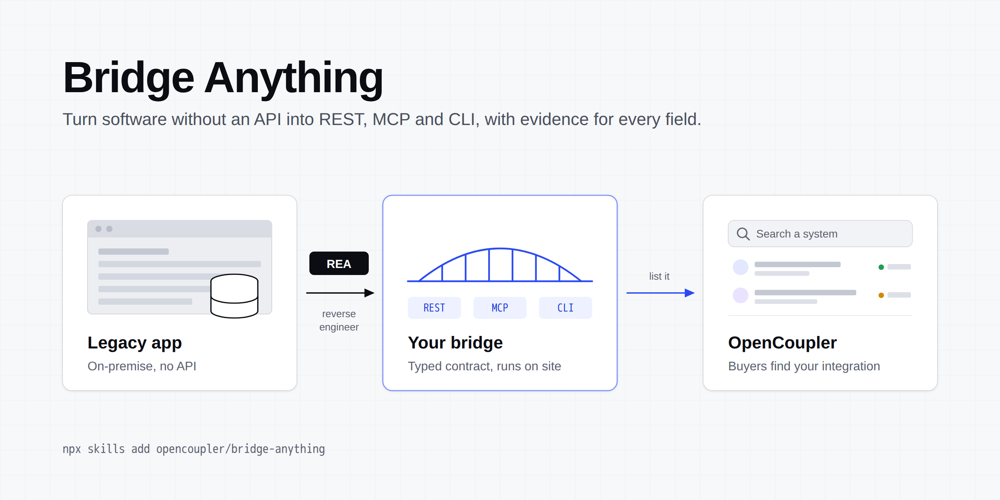

# Bridge Anything

[](https://skills.sh/opencoupler/bridge-anything)
[](LICENSE)

An agent skill that builds an integration into software that has no API.

Doctors' practice software, dealer systems, tax and accounting desktop apps, old ERPs: a lot of the world's data sits in systems of record that run on a server in the back office and offer no API, or one you can only get through a partner programme. Every agent, app and automation that wants that data stops there.

**Bridge Anything** gives your coding agent (Claude Code, Codex, Cursor and others) a method for getting through. It uses [REA (Reverse Engineer Anything)](https://github.com/morluto/rea) to find where the app keeps its data and how it reads and writes it, then builds a small **bridge** that runs next to the system and exposes that data as REST, MCP and a CLI. Every table, column and write path the bridge relies on is backed by evidence REA found.

When the bridge works, the skill can list it on [OpenCoupler](https://opencoupler.com), so the software companies and IT service providers looking for exactly that integration can find you.

## Install

```bash
npx rea-agents setup                          # connect REA to your agent
npx skills add opencoupler/bridge-anything    # add this skill
```

Restart your agent afterwards. The skill tells the agent how to work; REA gives it the tools to look inside the app.

## Ask your agent

```text
Use bridge-anything on the test installation in C:\Praxis\TestInstall.
We need to read patients and appointments for our booking app, and later
create appointments. I hold the licence for this installation.
```

Replace the path, the data and the purpose with your own.

## How it works

The skill runs six steps. Each one ends on a check the agent has to pass before it moves on.

1. **Establish the right to do this.** Whose installation, who agreed, what the vendor already offers. The bridge uses access a licensed user or administrator already has.
2. **Find where the data lives.** REA inspects the installation: runtime, database engine, connection config, export folders. The skill knows what SQL Server, Firebird, SQL Anywhere, Btrieve, Access, dBase, SQLite and others leave on disk.
3. **Map each data area.** Tables, keys, deletion, change markers, code tables, and how the app writes, read from its data-access code with REA and confirmed by diffing the database around one action. Results are checked against what the app shows on screen.
4. **Choose the access path.** Vendor API first, then interface files, then a read-only database user, then UI automation. Writes only through a path the app itself uses.
5. **Build the bridge.** Contract first, one source layer, thin REST, MCP and CLI adapters, write safeguards, tests against an anonymised snapshot, packaged to run on site.
6. **Publish (optional).** List the bridge on OpenCoupler through its MCP server, reviewed by a human before it goes public.

The agent keeps three files as it goes: `BRIDGE.md` (the map and the evidence), `UNKNOWNS.md` (open questions and how to answer them) and `DATA-PROTECTION.md` (what personal data the bridge touches and where it goes).

## Why use it?

Agents are good at writing a bridge once they know the data model. They are bad at knowing when they have guessed it. Without a method they read three table names, invent the rest, and write into a production database the way they think the app does.

This skill makes the agent prove each mapping, treat every write as dangerous until it has watched the app do it, and stop when the only way in is past an access control.

## Sell your bridge on OpenCoupler

[OpenCoupler](https://opencoupler.com) is a marketplace for integrations into on-premise and legacy software. Providers list an integration per system with its data areas, access method, hosting, data handling and price. Buyers compare providers, contact them on the platform, and vote for systems nobody covers yet, so you can see which bridges are in demand before you build one.

Browse the systems people are asking for at [opencoupler.com/systems](https://opencoupler.com/systems) and [opencoupler.com/requests](https://opencoupler.com/requests).

## Responsible use

Use this skill on installations you are licensed for or have written permission to analyse, for interoperability with your own software. It does not help circumvent licence checks, DRM, encrypted credentials or other access controls; when that is the only way in, ask the vendor or the customer's administrator. Analyse a copy, never the live system. Personal data in fixtures, logs and screenshots gets replaced before it leaves the test machine. See [legal and data protection](skills/bridge-anything/references/legal-and-data-protection.md) and REA's own [disclaimer](https://github.com/morluto/rea/blob/main/DISCLAIMER.md).

## Credits

Built on [REA](https://github.com/morluto/rea) by morluto (MIT). This project is independent and not affiliated with REA.

## License

[MIT](LICENSE)
